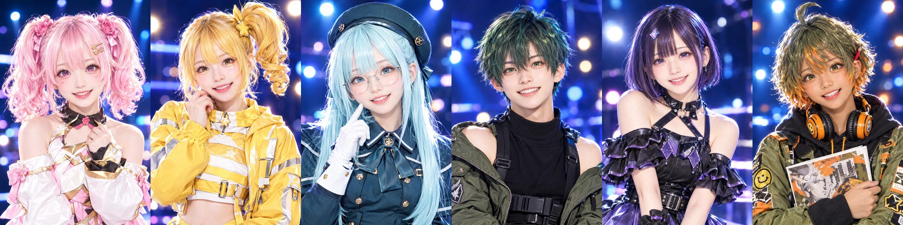

# AiCuty アーティスト写真 2026（フォトリアル・縦 2:3）

AiCuty 6 人のアーティスト写真です。2026-11-17〜18 に、国際AIクリエイターアワード2026（AICU Award 2026）の番組で使うために作りました。

| No. | メンバー | ファイル |
|---|---|---|
| 1 | Elena Bloom | `elena-artist-2026.webp` |
| 2 | Mei Soleil | `mei-artist-2026.webp` |
| 3 | Mina Azure | `mina-artist-2026.webp` |
| 4 | Nao Verde | `nao-artist-2026.webp` |
| 5 | Saki Noire | `saki-artist-2026.webp` |
| 6 | Marsha Arancia | `marsha-artist-2026-a.webp` / `-b.webp`（**2 案。どちらを採るか未決**） |

## 作り方

- 生成: GPT-Image-2.5 flare（OpenAI 直結・`gpt-image2` スキル）。1024x1536・quality high
- 参照:
  - 1 枚目は各キャラクターの公式シート（`<Name>/<Name>.png`。Marsha は `MarshaArancia/MarshaArancia-Standard.png`）
  - 2 枚目は画風の参照（award の公式フォトリアル KV `vote-open-261025/16x9/a-photo.webp`）
  - Marsha だけ、3 枚目にシリーズの参照として Mina のアーティスト写真を足した
- プロンプト: 5 人は `PROMPT.txt`（全員同じ）、Marsha は `PROMPT-marsha.txt`
- 費用: 1 枚 約 $0.06〜0.08

## 公式素材にする前に

- キャラクターの再現度を、人が確認してください（各キャラクターの `REVIEW.md` の作法に従う）。
- Marsha の既存の写真（`MarshaArancia/MarshaArancia-Photo-*.png`）は、大人びた実写寄りで、ほかの 5 人の写真と画風が揃いませんでした。そこで、このシリーズ用に作り直しました（CEO 2026-11-18「Marsha のフォトリアル画像がない」）。
- 使用中: award の番組「AiCuty が大予想！ファイナリスト」（https://www.youtube.com/watch?v=OHajWeDORk0 ）の 6 人のカード。この番組では、Marsha だけ KV を使っています。
